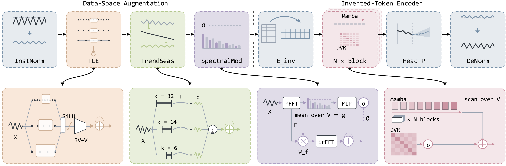

# CS-Mamba: Compensation-Based Mamba for Multivariate Time Series Forecasting

## Abstract

Inverted tokenization, which embeds the complete history of each variable as a single token, has made state-space models such as Mamba efficient and accurate multivariate forecasters. The same compression, however, is lossy: a single linear projection attenuates short-term transitions, entangles slow trends with rapid fluctuations, and encodes periodicity only implicitly, while a directional scan over variate tokens imposes an arbitrary ordering on variables that have no natural sequence. We propose **CS-Mamba**, a compensation-based forecaster that restores each type of structure in the representation space where it remains explicit. Before tokenization, three serial data-space modules operate on the raw temporal axis: **Temporal Locality Enhancement (TLE)** extracts multi-scale local patterns with lookback-adaptive dilated convolutions, **TrendSeasonal** re-injects fluctuations measured against moving trends at three adaptive scales, and **Adaptive Spectral Modulation (SpectralMod)** applies a sample-conditioned, variate-specific Fourier filter to recover global periodic structure. After tokenization, **Dynamic Variate Routing (DVR)** complements each Mamba layer with gated, order-invariant attention among all variates. Zero-initialized residual coefficients make the entire data-space stage an exact identity at initialization, so compensation is introduced only as training finds it useful. On six electricity, solar-energy, and traffic benchmarks, CS-Mamba achieves the lowest horizon-averaged MSE on four datasets and the best result in 28 of 48 dataset–horizon–metric settings, with gains of up to 22.4% over FLDmamba. Ablations show that every module contributes and that DVR matters most on high-dimensional traffic data. CS-Mamba is also robust to input noise and lookback length, and at full PEMS04 cardinality it trains about 1.5× faster than FLDmamba and 5.8× faster than PatchTST.

## Model Framework



*Vector source: [assets/cs-mamba-framework.pdf](assets/cs-mamba-framework.pdf)*

The pipeline compensates for the information lost by inverted tokenization: a serial **data-space** stage (TLE → TrendSeasonal → SpectralMod, each added as a zero-initialized residual) acts on the raw temporal axis before tokenization, and a **token-space** backbone (Mamba + DVR, stacked `e_layers` times) restores cross-variate structure afterwards.

## Installation

```bash
pip install -r requirements.txt
```

## Datasets

Large datasets are not tracked in this repository. Only `dataset/PEMS/PEMS07.npz` is included; download the remaining benchmarks (electricity, solar, ETT, other PEMS) separately and place them under `dataset/`.

## Train and evaluate

```bash
python -u run.py \
  --is_training 1 \
  --root_path ./dataset/PEMS/ \
  --data_path PEMS07.npz \
  --model_id PEMS07_96_12 \
  --model CSMamba \
  --data PEMS \
  --features M \
  --seq_len 96 \
  --pred_len 12 \
  --e_layers 1 \
  --enc_in 883 \
  --dec_in 883 \
  --c_out 883 \
  --d_model 512 \
  --d_ff 512 \
  --d_state 16 \
  --use_norm 0 \
  --learning_rate 0.0002 \
  --batch_size 16 \
  --dropout 0.1 \
  --itr 1 \
  --des 'Exp' \
  --use_tle 1 \
  --use_trend_seasonal 1 \
  --use_spectral_mod 1 \
  --use_dvr 1 \
  --gpu 0
```

The four compensation modules can be toggled independently via `--use_tle`, `--use_trend_seasonal`, `--use_spectral_mod`, and `--use_dvr` (set to `0` to disable the corresponding module for ablation).

## License

This project is released under the terms in [LICENSE](LICENSE).
